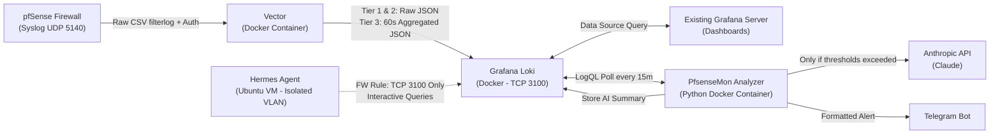

# PfsenseMon — AI-Powered pfSense Security Monitoring System

## 1. Understanding Summary

- **What is being built**: A containerized security monitoring and AI anomaly detection pipeline (**PfsenseMon**) for **pfSense** firewall logs, integrating **Vector** (Syslog ingestion, VRL parsing, and 60-second aggregation), **Grafana Loki** (log storage integrated with an existing **Grafana** server), a **Python AI Analyzer** container powered by the **Anthropic API (Claude)** and **Telegram Bot** notifications, plus an interactive investigation skill for **Hermes Agent**.
- **Why it exists**: Raw WAN firewall logs are dominated by Internet background radiation (automated bots and port scanners). Sending raw logs directly to an LLM wastes tokens and obscures high-value security signals. By filtering and pre-aggregating logs at the ingestion edge with Vector and applying a "Zero-Token" pre-check in Python, the system detects real threats (compromised internal devices, targeted scans, unauthorized access) at minimal cost.
- **Target Audience**: Network and firewall administrator seeking clear visibility via Grafana dashboards, proactive anomaly alerts on Telegram, and on-demand conversational threat hunting via Hermes Agent.
- **Monitoring Perimeter (3-Tier Hybrid Strategy)**:
  - **Tier 1 (`tier_1_outbound_suspicious`)**: Outbound traffic (`LAN/VLAN -> WAN`) blocked by the firewall or targeting non-standard ports (excluding standard web/DNS/NTP traffic on ports `80, 443, 53, 123`), aimed at spotting compromised internal hosts, C2 callbacks, or data exfiltration. Stored 1:1 without loss.
  - **Tier 2 (`tier_2_access_and_auth`)**: Inbound WAN traffic explicitly allowed (`action=pass`, e.g., exposed NAT services or VPNs) and pfSense authentication/system events (`sshd`, WebGUI logins, OpenVPN/WireGuard). Stored 1:1 without loss.
  - **Tier 3 (`tier_3_wan_blocked`)**: Inbound WAN traffic blocked by the firewall (`action=block`). Aggregated by Vector in 60-second windows by `(src_ip, dst_port, proto)` with a `hit_count` counter, reducing log volume by ~90% while preserving full statistical visibility.
- **Key Constraints**:
  - Docker Compose deployment for Vector, Loki, and the Python Analyzer.
  - Integration with an **already existing Grafana server** in the infrastructure.
  - Integration with an **already existing Hermes Agent** running on an Ubuntu VM inside an isolated VLAN (requiring only a single read-only firewall rule to Loki on `TCP 3100`).
  - Language policy: All user interactions in chat take place in Italian; all code, comments, configurations, and documentation are written in English.
- **Explicit Non-Goals (v1)**:
  - No automated firewall rule mutation (auto-ban) on pfSense to avoid accidental lockouts caused by false positives.
  - No Deep Packet Inspection (payload inspection); analysis operates on Syslog metadata (`filterlog` and system daemons).

---

## 2. Assumptions & Non-Functional Requirements

- **Scale & Traffic Volume**: Home Lab / SMB environment (1 pfSense appliance generating hundreds to a few thousand firewall events per minute).
- **Performance & API Cost Control**:
  - Batch evaluation runs every **15 minutes** (configurable via environment variables).
  - **Zero-Token Pre-Filter**: The Python service evaluates event counts and thresholds locally against Loki before calling the Anthropic API. If no Tier 1/2 anomalies occur and Tier 3 WAN blocks remain below threshold, **0 Anthropic API tokens** are consumed.
  - Prompt payload is capped (top 25 aggregated offenders/events per window) to guarantee predictable token usage and low latency.
- **Security & Privacy**:
  - Secrets (`ANTHROPIC_API_KEY`, `TELEGRAM_BOT_TOKEN`, `TELEGRAM_CHAT_ID`) are injected exclusively via an unversioned `.env` file.
  - Syslog (`UDP 5140`) and Loki (`TCP 3100`) are bound to the internal management network only.
  - Hermes Agent remains isolated in its dedicated VLAN, granted strictly scoped access (`Hermes_IP -> Loki_IP:3100/TCP`).
- **Reliability & Storage Retention**:
  - Loki retention is configured to **30 days** by default with automatic compaction.
  - Vector uses disk-backed buffering so temporary Loki restarts do not drop incoming pfSense Syslog packets.

---

## 3. Decision Log

| Decision | Alternatives Considered | Rationale |
| :--- | :--- | :--- |
| **Vector + Loki in Docker linked to existing Grafana** | Deploying a duplicate Grafana container; using plain flat-file Syslog | Reuses the existing Grafana instance as a visualization frontend while Loki provides fast label-based indexing (`security_tier`, `interface`, `action`, `direction`). |
| **3-Tier classification with 60s WAN block aggregation in Vector** | Storing 100% raw blocked WAN packets; monitoring only outbound traffic | Compresses repetitive WAN scanner noise by ~90% (`hit_count`) while keeping 100% granularity for high-priority outbound anomalies (Tier 1) and auth/allowed access (Tier 2). |
| **Hybrid Architecture: Deterministic Python Container + Hermes Skill** | Running a 15-minute native LLM cron inside Hermes; completely isolating Hermes | Native Hermes cron jobs invoke an LLM session on every tick (96x/day) even when idle. A lightweight Python container performs a free local check ("Zero-Token Filter") and calls Anthropic only on anomalies, while Hermes acts as an interactive on-demand SOC analyst. |
| **Multi-Provider & Local LLM Engine (`LLM_PROVIDER`)** | Hardcoding Anthropic SDK only; adding heavy `litellm`/`openai` dependencies | Supports `anthropic` (MiniMax/Claude via `/v1/messages`), `ollama` (local models without API key), `openai` (LM Studio/vLLM/OpenAI via `/v1/chat/completions`), and `openrouter` using native `httpx` while keeping 100% `.env` backward compatibility. |
| **Post-Filter GeoIP & ASN Enrichment (`analyzer/src/geoip.py`)** | Enriching every raw packet in Vector VRL; shipping heavy `.mmdb` databases | Runs batch GeoIP/ASN resolution only when `should_invoke_ai == True` (preserving 0 external calls during quiet windows) and enriches both the LLM prompt payload and Telegram alerts (`ENABLE_GEOIP=true/false`). |
| **Self-Contained Defensive Bash Quick-Start Wizard (`setup.sh`)** | Thin Bash wrapper + Python wizard inside Docker container; multi-file Bash library (`scripts/lib/*.sh`); requiring Python 3.12+ / `uv` on the host | Zero host Python dependencies required (runs on macOS Bash 3.2+ and Linux Bash 4+ with just `bash`, `curl`, and `docker compose`), avoids container UID/GID `.env` permission pitfalls, detects the host's physical LAN IP directly, uses a multi-fallback JSON helper (`python3`/`jq`/POSIX `grep`+`sed`) for live `/v1/models` and Telegram `/getUpdates` auto-discovery, and delegates E2E smoke testing to the running `analyzer` container. |
| **Dual Output: Telegram Alert + `[AI_REPORT]` ingestion back into Loki** | Telegram only; Email only | Telegram provides instant mobile alerting, while pushing the AI analysis back into Loki allows viewing historical Claude reports inside a dedicated Grafana panel. |
| **English for all code and documentation** | Italian or mixed language in codebase | Follows standard software engineering best practices and explicit project rule (`AGENTS.md`). |

---

## 4. System Architecture & Data Flow



### 4.1 Component Breakdown

1. **`vector` (`timberio/vector`)**:
   - **Input**: Listens on `0.0.0.0:5140/UDP` for pfSense syslog messages.
   - **Processing (VRL)**:
     - Parses standard pfSense `filterlog` CSV payloads (IPv4 and IPv6) and authentication daemons (`sshd`, `openvpn`, `wireguard`, `php-fpm` WebGUI).
     - Drops irrelevant local chatter (link-local IPv6 `fe80::`/`ff02::`, IGMP, mDNS, local broadcast).
     - Assigns `security_tier` (`tier_1_outbound_suspicious`, `tier_2_access_and_auth`, `tier_3_wan_blocked`).
     - Routes `tier_3_wan_blocked` through a `reduce` transform (60s window grouped by `src_ip`, `dst_port`, `proto`, `interface`) accumulating `hit_count`.
   - **Output**: Ships structured JSON logs to `http://loki:3100/loki/api/v1/push` with low-cardinality labels (`app="pfsense"`, `security_tier`, `action`, `direction`).

2. **`loki` (`grafana/loki`)**:
   - **Storage**: TSDB single-store configuration on local Docker volume with 30-day retention Policy enabled via Compactor.
   - **API**: Exposes port `3100/TCP` for Grafana Data Source integration, the Python Analyzer, and the Hermes Agent skill.

3. **`analyzer` (Custom Python Container)**:
   - **Scheduler**: Runs a deterministic check every `ANALYSIS_INTERVAL_MINUTES` (default: `15`).
   - **Zero-Token Filter**: Queries Loki across the 3 tiers. Triggers Anthropic API analysis only if:
     - Any `tier_1_outbound_suspicious` event is present (excluding whitelisted internal IPs/ports), OR
     - Any anomalous `tier_2_access_and_auth` event is present (e.g., failed logins or unexpected WAN `pass` traffic), OR
     - Any `tier_3_wan_blocked` source IP exceeds `WAN_BLOCK_THRESHOLD` hits (e.g., 50 hits) or scans more than `WAN_PORT_SCAN_THRESHOLD` distinct ports (e.g., 10 ports) within the window.
   - **Deduplication Cache**: Tracks recently alerted `(src_ip, tier, reason)` tuples with a configurable cooldown TTL (default: `120` minutes) to prevent alert fatigue during sustained scans.
   - **AI Evaluation**: Calls Anthropic (`claude-sonnet-4-5` or configurable model) with a structured system prompt returning severity (`INFO`, `WARNING`, `CRITICAL`), executive summary, technical breakdown, and recommended remediation.
   - **Notification & Persistence**: Sends a Markdown-formatted message to Telegram and pushes the report back to Loki with label `security_tier="ai_report"`.

4. **`hermes_skill` (Standalone CLI & Skill for Hermes Agent on Ubuntu)**:
   - A zero-dependency (or minimal `requests`/`urllib`) Python CLI tool and `SKILL.md` descriptor to install on the Hermes Ubuntu VM.
   - Supports commands such as:
     - `summary --hours 24`: Aggregated overview of Tier 1, 2, and 3 events.
     - `inspect-ip <IP> --days 7`: Full timeline of activity for a specific IP in Loki.
     - `outbound-anomalies --hours 24`: Detailed list of internal devices triggering Tier 1 rules.

---

## 5. Error Handling, Edge Cases & Testing Strategy

### 5.1 Error Handling
- **Loki Downtime**: Vector buffers incoming UDP syslog events on disk (`buffer.type = "disk"`) and retries automatically when Loki recovers.
- **Anthropic API Failures**: The Python Analyzer implements exponential backoff (3 retries on HTTP 429/5xx). If Anthropic remains unreachable during a high-priority event, the Analyzer sends a **fallback raw statistical alert** directly to Telegram so critical security events are never silently dropped.
- **Telegram Delivery Failures**: Logged locally and pushed to Loki (`security_tier="system_error"`) with retry logic.

### 5.2 Edge Cases
- **High-Volume Legitimate Outbound Traffic**: Configurable `WHITELIST_INTERNAL_IPS` and `WHITELIST_OUTBOUND_PORTS` in `.env` prevent noisy false positives from known P2P, gaming, or backup applications.
- **DDoS / Massive Distributed Scans**: The Python aggregator summarizes total volume and truncates the offender table sent to Claude to the **Top 25 sources**, preventing token overflow.

### 5.3 Testing Strategy
- **Synthetic Log Generator (`scripts/simulate_pfsense_logs.py`)**: Sends realistic pfSense `filterlog` and `sshd` UDP syslog packets to Vector (`localhost:5140`), simulating:
  1. Normal background WAN noise (below threshold),
  2. Aggressive multi-port WAN scan from a single external IP (Tier 3 threshold breach),
  3. Suspicious outbound connection from a LAN IP to port `4444/TCP` (Tier 1 alert),
  4. Failed SSH / WebGUI login attempts (Tier 2 alert).
- **Unit Tests (`tests/`)**: Pytest suite testing VRL parsing logic, Python Zero-Token threshold evaluation, deduplication cache, and Anthropic/Telegram payload formatting.

---

## 6. Planned Repository Structure

```text
PfsenseMon/
├── AGENTS.md                        # Project rules (Italian chat / English code & docs)
├── DESIGN.md                        # Validated architecture and design specification
├── README.md                        # Step-by-step setup guide (pfSense, Docker, Grafana, Hermes)
├── setup.sh                         # Self-contained interactive Quick-Start & onboarding wizard
├── docker-compose.yml               # Vector + Loki + Python AI Analyzer stack
├── .env.example                     # Template for API keys, thresholds, and whitelists
├── config/
│   ├── vector/
│   │   └── vector.yaml              # Syslog ingestion, VRL parsing, 3-tier classification & 60s reduce
│   ├── loki/
│   │   └── loki-config.yaml         # Loki single-binary configuration with 30-day retention
│   └── grafana/
│       └── dashboard-pfsense.json   # Ready-to-import Grafana dashboard for the 3 tiers + AI reports
├── analyzer/
│   ├── Dockerfile                   # Lightweight Python 3.12 container image
│   ├── requirements.txt             # Dependencies (anthropic, httpx, pydantic, etc.)
│   └── src/
│       ├── __init__.py
│       ├── config.py                # Environment configuration & thresholds
│       ├── loki_client.py           # LogQL querying, aggregation & pushing AI reports back to Loki
│       ├── filter_engine.py         # Zero-Token threshold evaluator & anti-spam deduplication cache
│       ├── ai_analyst.py            # Anthropic Claude API client & SOC prompt engineering
│       ├── notifier.py              # Telegram Bot notifier with raw fallback support
│       └── main.py                  # Scheduler loop & CLI entrypoint
├── hermes_skill/
│   ├── SKILL.md                     # Hermes Agent skill definition and usage instructions
│   └── query_pfsense_loki.py        # Self-contained CLI script for Hermes to query Loki
├── scripts/
│   └── simulate_pfsense_logs.py     # Traffic simulator to test the pipeline before touching pfSense
└── tests/
    ├── test_filter_engine.py        # Unit tests for Zero-Token filter and deduplication logic
    ├── test_regressions.py          # Regression suite (Local LLMs, Structured Output, GeoIP, VRL & Wiki lint)
    ├── test_scheduler_and_redaction.py # Scheduler catch-up and secret redaction tests
    └── test_setup_wizard.py         # Automated tests for setup.sh (--help, --check, .env generation & permissions)
```

---

## 7. Interactive Quick-Start & Onboarding Wizard (`setup.sh`)

### 7.1 Understanding Summary
- **What is being built**: An interactive, self-contained Quick-Start and onboarding script (`setup.sh`) in the project root that takes a freshly cloned repository through prerequisite checks, guided `.env` generation with live auto-discovery, Docker Compose deployment, and optional end-to-end synthetic verification.
- **Why it exists**: Manual `.env` configuration is error-prone (host vs. container URLs for local LLMs, model identifier typos, numeric Telegram `chat_id` lookup, timeout tuning for local models). `setup.sh` reduces onboarding to under 2 minutes while providing immediate E2E confidence.
- **Target Audience**: Network administrators, homelab/SOHO operators, and developers deploying `PfsenseMon` on macOS (Apple Silicon) or Linux hosts.
- **Key Constraints**:
  - Zero host Python package dependencies required: runs anywhere with standard `bash` (compatible with macOS Bash 3.2+ and Linux Bash 4+/5+), `curl`, and `docker compose`.
  - Express + Advanced flow: prompts only for essential settings (LLM provider/model, report language, Telegram credentials) with provider-aware smart defaults, offering an optional `[y/N]` toggle for advanced ports, thresholds, and whitelists.
- **Explicit Non-Goals**:
  - Does not auto-install Docker Engine or OS packages via `apt`/`brew`.
  - Does not mutate remote pfSense/OPNsense appliances or SSH into the Hermes VM automatically (prints ready-to-copy snippets populated with the detected Docker host LAN IP instead).

### 7.2 Assumptions & Non-Functional Requirements
- **Credential Security**: `.env` and any `.env.bak` backups are written atomically with `chmod 600` (`umask 077`). Secret inputs (`ANTHROPIC_API_KEY`, `OPENROUTER_API_KEY`, `LLM_API_KEY`, `TELEGRAM_BOT_TOKEN`) use silent terminal reads (`read -r -s`) and are never echoed to stdout logs.
- **Cross-Platform Compatibility**: Avoids Bash 4+-only associative arrays (`declare -A`) and GNU-specific `sed -i` flags so the script runs identically on macOS (`bash 3.2`) and Linux.
- **Dual Host/Container URL Mapping**: When probing local LLM servers (`LM Studio` on port `1234` or `Ollama` on port `11434`) during the wizard, `setup.sh` queries `http://localhost:<port>/v1/models` from the host, while persisting `http://host.docker.internal:<port>/v1` into `.env` for the `analyzer` container.
- **Network Timeouts**: All live discovery HTTP calls (`curl`) enforce `--max-time 5` with graceful manual fallback if an endpoint is offline.

### 7.3 Wizard Decision Log

| Decision | Alternatives Considered | Rationale |
| :--- | :--- | :--- |
| **Full Guided Onboarding Scope** | Config-only generator; full OS package installer | Covers pre-flight checks, `.env` wizard, `docker compose up -d --build`, optional E2E smoke test, and final copy-paste integration summary without risky OS-level package mutations. |
| **Zero Host Python Dependencies (Bash 3.2+ + `curl` + multi-fallback JSON helper)** | Requiring Python 3.12 + `uv` + `rich` on host; running wizard inside a temporary Docker container | Allows immediate execution on bare Linux servers and macOS without pre-building containers or hitting container UID/GID permission issues when writing `.env`. |
| **Idempotent Existing `.env` Handling with `.env.bak` (`0600`)** | Always overwriting; aborting if `.env` exists | Lets users safely re-run `./setup.sh` to either keep their current `.env`, reconfigure with an automatic backup, or jump straight to E2E diagnostics. |
| **Assisted Auto-Discovery (`/v1/models` + Telegram `/getUpdates`)** | Blind text input only | Eliminates model name typos on LM Studio/Ollama/OpenRouter and resolves numeric `TELEGRAM_CHAT_ID` interactively when the user sends `/start` to their bot. |
| **Two-Speed Smoke Test (Fast ~10s vs. Full ~65s)** | Forcing a mandatory 65s wait every time | Fast mode injects Tier 1 (`outbound`) and Tier 2 (`auth`) scenarios (forwarded 1:1 by Vector without the 60s Tier 3 `reduce` window), while Full mode tests all 3 tiers including the 60s aggregation flush. |

### 7.4 Architecture & CLI Modes (`setup.sh`)
1. **CLI Flags**:
   - `./setup.sh` (default): Interactive onboarding workflow.
   - `./setup.sh --check`: Non-interactive pre-flight and `.env` validation (exit code `0` if valid, non-zero otherwise).
   - `./setup.sh --test-only`: Runs the interactive E2E smoke test against the running stack.
   - `./setup.sh --non-interactive`: Generates `.env` from environment variables/defaults for automated testing.
   - `./setup.sh --help`: Displays usage documentation.
2. **Internal Modules**:
   - `ui_helpers`: ANSI styling (respecting `NO_COLOR`), `prompt_choice`, `prompt_input`, `prompt_secret`, `json_extract` (`python3` -> `jq` -> POSIX `grep`/`sed`).
   - `preflight_checks`: Verifies `docker`, `docker compose`, `curl`, Docker daemon readiness, port availability (`UDP 5140`, `TCP 3100`), and detects host LAN IP (`detect_host_ip`).
   - `env_wizard`: Handles existing `.env` menu, provider selection (`LM Studio`, `Ollama`, `MiniMax`, `Anthropic`, `OpenRouter`, `OpenAI-compatible`), live `/v1/models` discovery, Telegram `/getMe` + `/getUpdates` `chat_id` discovery, optional advanced settings, and `0600` file generation.
   - `stack_deploy`: Executes `docker compose up -d --build` and polls `http://localhost:${LOKI_HTTP_PORT}/ready` until healthy.
   - `smoke_test`: Executes `simulate_pfsense_logs.py` and `python -m src.main --once --reset-dedup` inside `pfsensemon-analyzer` (Fast ~10s or Full ~65s; Dry-Run or Live AI + Telegram).
   - `print_next_steps`: Outputs pre-filled configuration snippets for pfSense Remote Syslog, Grafana Loki Data Source, and the Hermes Agent skill using the detected `<HOST_IP>`.

