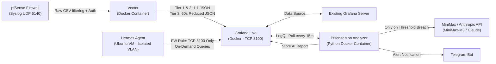

# XSenseMonAI — AI-Powered pfSense and OPNsense Security Monitoring System

**XSenseMonAI** is a containerized security telemetry pipeline and AI anomaly detection system for **pfSense** firewalls. It combines **Vector** (high-speed Syslog parsing and 60-second edge aggregation), **Grafana Loki** (lightweight log storage connected to your existing **Grafana** server), a **Python AI Analyzer** powered by **MiniMax / Anthropic-compatible LLMs** (`MiniMax-M3`, `MiniMax-M2.5`, or `Claude`), **Telegram Bot** mobile alerting, and an interactive CLI skill for **Hermes Agent**.

## Key Features

- **3-Tier Hybrid Security Monitoring**:
  - 🔴 **Tier 1 (`tier_1_outbound_suspicious`)**: Captures 100% of blocked outbound (`LAN/VLAN -> WAN`) connections, outbound traffic to non-standard ports, and blocked inter-VLAN lateral movement to detect compromised internal hosts, malware C2 callbacks, or data exfiltration.
  - 🟠 **Tier 2 (`tier_2_access_and_auth`)**: Captures 100% of pfSense authentication events (`sshd`, WebGUI `webConfigurator`, OpenVPN, WireGuard, IPsec) and inbound WAN `pass` connections.
  - 🟡 **Tier 3 (`tier_3_wan_blocked`)**: Pre-aggregates repetitive inbound WAN `block` events in 60-second windows by `(src_ip, dst_port, proto)` using Vector's `reduce` transform—cutting storage and token noise by ~90% while preserving full statistical visibility (`hit_count`).
- **Zero-Token Pre-Filter Engine**: The Python Analyzer queries Loki every 15 minutes and evaluates thresholds locally. If only harmless Internet background noise is present, **0 LLM API tokens are spent**.
- **MiniMax & Anthropic-Compatible API Support**: Supports both **MiniMax** (`https://api.minimax.io/anthropic` with `MiniMax-M3` / `MiniMax-M2.5`) and official **Anthropic Claude** models out of the box via `ANTHROPIC_BASE_URL`, automatically filtering reasoning `thinking` blocks.
- **Anti-Spam Deduplication, Telegram Auto-Discovery & Raw Fallback**: Suppresses repeated alerts for the same ongoing scanner (configurable TTL cooldown), automatically discovers your numeric Telegram `chat_id` via `getUpdates` when you press `/start` on your bot, and sends a raw statistical Telegram alert if the AI API is temporarily unreachable.
- **Hermes Agent SOC Integration**: Includes a zero-dependency Python CLI tool and `SKILL.md` for your isolated Ubuntu **Hermes Agent**, enabling on-demand conversational threat hunting over Loki (`TCP 3100`).
- **Self-Maintaining LLM Wiki (Karpathy Pattern + Google OKF)**: Includes a structured knowledge base under [`wiki/`](wiki/index.md) following Andrej Karpathy's *LLM Wiki* pattern and Google Cloud's *Open Knowledge Format (`okf/SPEC.md`)*, audited automatically by `pytest`.

---

## Tech Stack

- **Log Ingestion & Edge Aggregation**: [Vector](https://vector.dev/) (`timberio/vector:0.39.0-alpine`) using VRL (Vector Remap Language)
- **Log Storage**: [Grafana Loki](https://grafana.com/oss/loki/) (`grafana/loki:3.0.0`) with 30-day automatic TSDB retention
- **Visualization**: Integrates as a Data Source into your **existing Grafana server** (pre-built dashboard included)
- **AI Analyzer Service**: Python 3.12+, `anthropic` SDK (`>=2.2.0`), `httpx`, `pydantic` v2
- **Package & Environment Management**: [`uv`](https://docs.astral.sh/uv/), `pytest`, `ruff`
- **CI/CD**: GitHub Actions (`.github/workflows/ci.yml`) validating Python 3.12/3.13, Vector VRL syntax, OKF Wiki integrity, and Docker builds
- **Alerting**: Telegram Bot HTTP API + `[AI_REPORT]` stream ingestion back into Loki
- **Interactive SOC Agent**: Hermes Agent custom skill (`hermes_skill/`)

---

## Architecture



### Directory Structure

```text
PfsenseMon/
├── .github/
│   └── workflows/
│       └── ci.yml                   # GitHub Actions CI (Ruff, Pytest, Vector VRL validate, Docker build)
├── AGENTS.md                        # Project rules (Italian chat / English code & docs + OKF Wiki policy)
├── DESIGN.md                        # Architecture specification & decision log
├── LICENSE                          # Apache License 2.0
├── README.md                        # Complete setup & operations guide
├── pyproject.toml                   # Python project metadata & pytest/ruff config
├── docker-compose.yml               # Vector + Loki + Python Analyzer stack
├── .env.example                     # Environment variables template
├── config/
│   ├── vector/
│   │   └── vector.yaml              # Syslog UDP 5140 source, VRL parser, 3-Tier router & 60s reduce
│   ├── loki/
│   │   └── loki-config.yaml         # Loki TSDB configuration with 30-day retention
│   └── grafana/
│       └── dashboard-pfsense.json   # Ready-to-import Grafana dashboard JSON
├── analyzer/
│   ├── Dockerfile                   # Non-root Python 3.12 container image
│   ├── requirements.txt             # Python dependencies
│   └── src/
│       ├── __init__.py
│       ├── config.py                # Environment configuration & ANTHROPIC_BASE_URL normalization
│       ├── models.py                # Pydantic v2 data models
│       ├── loki_client.py           # LogQL query_range & push client
│       ├── filter_engine.py         # Zero-Token threshold evaluator & TTL deduplication cache
│       ├── ai_analyst.py            # MiniMax / Anthropic API client with thinking-block filter & retry
│       ├── notifier.py              # Telegram Bot HTML notifier, chat_id auto-discovery & fallback
│       └── main.py                  # Periodic scheduler & CLI entrypoint
├── hermes_skill/
│   ├── SKILL.md                     # Hermes Agent skill definition
│   └── query_pfsense_loki.py        # Zero-dependency CLI script for Hermes Ubuntu VM
├── scripts/
│   └── simulate_pfsense_logs.py     # Synthetic pfSense UDP syslog generator for testing
├── tests/
│   ├── test_filter_engine.py        # Core unit tests (Zero-Token filter, dedup, URL normalization)
│   └── test_regressions.py          # Regression suite (MiniMax SDK, Telegram auto-discovery, VRL & Wiki lint)
└── wiki/                            # Karpathy LLM Wiki + Google Cloud OKF Knowledge Base
    ├── index.md                     # Root OKF catalog (okf_version: "1.0") for progressive disclosure
    ├── log.md                       # Chronological project & operational log
    ├── SCHEMA.md                    # Wiki governance & OKF YAML frontmatter specification
    ├── concepts/                    # Architectural & security concepts
    ├── components/                  # Detailed component documentation
    ├── runbooks/                    # Operational & testing procedures
    └── raw/                         # Immutable verification traces & test outputs
```

---

## Prerequisites

- **Docker** and **Docker Compose v2** installed on the host that will run `PfsenseMon`.
- **[`uv`](https://docs.astral.sh/uv/)** (optional, recommended for local Python development and running tests).
- Network reachability from your **pfSense firewall** to the Docker host on **UDP port `5140`**.
- A **MiniMax API Key** ([platform.minimax.io](https://platform.minimax.io/)) or **Anthropic API Key** ([console.anthropic.com](https://console.anthropic.com/)).
- A **Telegram Bot Token** (created via `@BotFather`) and a Telegram account to receive alerts.

---

## Step-by-Step Setup Guide

### Step 1: Configure Environment Variables

Copy `.env.example` to `.env`:

```bash
cp .env.example .env
```

Edit `.env` with your credentials and network preferences:

| Variable | Description | Default / Example |
| :--- | :--- | :--- |
| `ANTHROPIC_API_KEY` | Your MiniMax or Anthropic API secret key | `eyJ...` or `sk-ant-...` |
| `ANTHROPIC_BASE_URL` | Anthropic-compatible base URL (MiniMax or Anthropic) | `https://api.minimax.io/anthropic` |
| `ANTHROPIC_MODEL` | Model used for security analysis | `MiniMax-M3` (or `MiniMax-M2.5`, `claude-sonnet-4-5`) |
| `AI_REPORT_LANGUAGE` | Language used by the AI for report summaries | `Italian` |
| `TELEGRAM_BOT_TOKEN` | Telegram Bot token from `@BotFather` | `123456:AAF...` |
| `TELEGRAM_CHAT_ID` | Numeric Telegram chat ID (or bot username for auto-discovery) | `123456789` |
| `VECTOR_SYSLOG_PORT` | UDP port exposed for pfSense syslog | `5140` |
| `LOKI_HTTP_PORT` | TCP port exposed for Grafana & Hermes | `3100` |
| `ANALYSIS_INTERVAL_MINUTES` | Frequency of automated AI checks | `15` |
| `WAN_BLOCK_HIT_THRESHOLD` | Blocked packets from 1 IP to trigger Tier 3 | `50` |
| `WAN_PORT_SCAN_THRESHOLD` | Distinct ports from 1 IP to flag a Port Scan | `8` |
| `ALERT_DEDUP_TTL_MINUTES` | Cooldown before re-alerting on the same offender | `120` |
| `WHITELIST_INTERNAL_IPS` | Comma-separated LAN IPs excluded from Tier 1 | `192.168.1.50` |
| `WHITELIST_OUTBOUND_PORTS` | Standard outbound ports excluded from Tier 1 pass | `53,80,123,443,465,587,853,993,51820,1194` |

> **Automatic Telegram `chat_id` Discovery**: If you don't know your numeric Telegram `chat_id`, you can initially put your bot's username in `TELEGRAM_CHAT_ID`, open Telegram, search for your bot, and press **Start (`/start`)**. On the next run, `TelegramNotifier` will automatically query `/getUpdates`, discover your numeric `chat_id`, deliver the alert, and print the numeric ID in the logs.

---

### Step 2: Start the Docker Compose Stack

Build and launch **Loki**, **Vector**, and the **Python AI Analyzer**:

```bash
docker compose up -d --build
```

Verify that all three containers are running and healthy:

```bash
docker compose ps
docker compose logs -f vector analyzer
```

---

### Step 3: Test the Pipeline End-to-End (Before Touching pfSense)

Run the synthetic log generator inside the `analyzer` container (or from the host) to send realistic pfSense `filterlog` and `sshd`/`php-fpm` packets (background noise, a 65-packet 12-port WAN scan, a suspicious LAN outbound C2 connection to port `4444`, and failed SSH/WebGUI logins) to Vector on `UDP 5140`:

```bash
docker compose exec analyzer python /app/scripts/simulate_pfsense_logs.py --host vector --port 5140 --scenario all
```

Wait ~60 seconds for Vector's `reduce` window to flush the aggregated WAN blocks to Loki, then trigger an immediate analysis cycle:

```bash
# Dry-run first (verifies Loki query & Zero-Token filter without spending tokens):
docker compose exec analyzer python -m src.main --once --dry-run --reset-dedup

# Full live run (calls MiniMax/Anthropic API, sends Telegram alert, and saves report in Loki):
docker compose exec analyzer python -m src.main --once --reset-dedup
```

---

### Step 4: Configure pfSense Remote Syslog Forwarding

1. Log in to your **pfSense WebGUI**.
2. Navigate to **Status** → **System Logs** → **Settings**.
3. Scroll down to the **Remote Logging Options** section:
   - Check **Enable Remote Logging** (`Send log messages to remote syslog server`).
   - **Source Address**: Select your **LAN** interface (or the interface that can reach your Docker host).
   - **IP Protocol**: `IPv4`.
   - **Remote log servers**: Enter `<DOCKER_HOST_IP>:5140` (e.g., `192.168.1.20:5140`).
   - **Remote Syslog Contents**: Check:
     - ✅ **Firewall Events**
     - ✅ **System Events** / **General**
     - ✅ **SSH Daemon** / **Authentication**
     - ✅ **VPN Events** (OpenVPN / WireGuard / IPsec, if used)
4. Click **Save** at the bottom of the page.

> **Tip**: Under **Status → System Logs → Settings**, ensure **Log packets matched from the default block rules in the ruleset** is checked (it is enabled by default in pfSense).

---

### Step 5: Connect Your Existing Grafana Server

1. Open your existing **Grafana** web interface.
2. Go to **Connections** → **Data sources** → **Add new data source** → Select **Loki**.
3. Set the **HTTP URL** to:
   ```text
   http://<DOCKER_HOST_IP>:3100
   ```
4. Click **Save & test** (Grafana will confirm *"Data source successfully connected"*).
5. To import the ready-made dashboard:
   - Go to **Dashboards** → **New** → **Import**.
   - Upload [`config/grafana/dashboard-pfsense.json`](config/grafana/dashboard-pfsense.json).
   - Select your **Loki** data source and click **Import**.

---

### Step 6: Configure Hermes Agent (Isolated VLAN Integration)

To allow **Hermes Agent** (running on its isolated Ubuntu VM) to investigate pfSense logs on demand without exposing the rest of your network:

#### 6.1 Create the Scoped Firewall Rule on pfSense
1. In pfSense WebGUI, go to **Firewall** → **Rules** → Select the **Hermes VLAN** tab.
2. Click **Add** (top of the list, **above** any block/isolation rule):
   - **Action**: `Pass`
   - **Interface**: `Hermes VLAN`
   - **Address Family**: `IPv4`
   - **Protocol**: `TCP`
   - **Source**: `Single host or alias` → `<HERMES_UBUNTU_VM_IP>`
   - **Destination**: `Single host or alias` → `<DOCKER_HOST_IP>`
   - **Destination Port Range**: `3100` to `3100`
   - **Description**: `Allow Hermes Agent read-only query access to PfsenseMon Loki`
3. Click **Save** and **Apply Changes**.

#### 6.2 Install the Skill on the Hermes Ubuntu VM
Copy the `hermes_skill` folder to your Hermes skills directory on the Ubuntu VM:

```bash
mkdir -p ~/.hermes/skills/pfsense-security-monitor
cp hermes_skill/SKILL.md hermes_skill/query_pfsense_loki.py ~/.hermes/skills/pfsense-security-monitor/
chmod +x ~/.hermes/skills/pfsense-security-monitor/query_pfsense_loki.py
```

Add `LOKI_URL` to `~/.hermes/.env` on the Ubuntu VM:

```bash
echo "LOKI_URL=http://<DOCKER_HOST_IP>:3100" >> ~/.hermes/.env
```

Test connectivity directly from the Hermes Ubuntu VM:

```bash
python3 ~/.hermes/skills/pfsense-security-monitor/query_pfsense_loki.py summary --hours 24
```

Now you can message Hermes on Telegram at any time:
- *"Hermes, dammi un riassunto della sicurezza di pfSense nelle ultime 24 ore."*
- *"Hermes, controlla su Loki cosa ha fatto l'IP 185.220.101.42 negli ultimi 7 giorni e fai un whois."*
- *"Hermes, ci sono stati dispositivi interni con traffico sospetto in uscita oggi?"*

---

## Local Development, Testing & CI (`uv` + `pytest` + GitHub Actions)

### 1. Set Up the Local Virtual Environment with `uv`

```bash
uv venv
uv pip install -r analyzer/requirements.txt pytest ruff
source .venv/bin/activate
```

### 2. Run Linter and Unit/Regression Tests

```bash
ruff check analyzer hermes_skill scripts tests
pytest -v
```

The test suite (`11` tests across [`tests/test_filter_engine.py`](tests/test_filter_engine.py) and [`tests/test_regressions.py`](tests/test_regressions.py)) validates:
- **Zero-Token Pre-Filter & Whitelists**: Guarantees `0` API calls when traffic is within normal bounds.
- **Port-Scan Detection & TTL Deduplication Cache**: Ensures multi-port scanners trigger once and respect cooldown windows.
- **MiniMax-M3 / Anthropic Compatibility**: Verifies `ANTHROPIC_BASE_URL` normalization, absence of unsupported `temperature` arguments, and filtering of `thinking` blocks.
- **Telegram `getUpdates` Auto-Discovery & HTML Escaping**: Ensures bot usernames are automatically resolved to numeric `chat_id`s and special characters (`<`, `>`, `&`) are escaped.
- **Vector VRL Static Guard & OKF Wiki Integrity Linter**: Verifies `config/vector/vector.yaml` contains no fallible VRL anti-patterns and audits all files in [`wiki/`](wiki/index.md) for valid OKF YAML frontmatter and unbroken Markdown links.

### 3. Continuous Integration (`.github/workflows/ci.yml`)

Every `push` and `pull_request` to `main` triggers two automated GitHub Actions jobs:
1. **`lint-and-test`**: Runs `ruff check` and `pytest -v` across Python `3.12` and `3.13` using `astral-sh/setup-uv@v5`.
2. **`validate-vector-and-docker`**: Validates `config/vector/vector.yaml` using the official `timberio/vector:0.39.0-alpine` container (`validate --no-environment`) and builds the `analyzer` Docker image.

---

## Project Knowledge Base (`wiki/`)

This repository maintains a self-compounding **LLM Wiki** under [`wiki/`](wiki/index.md) combining:
- **[Andrej Karpathy's LLM Wiki Pattern](https://gist.github.com/karpathy/442a6bf555914893e9891c11519de94f)** (`ingest`, `query`, `lint` workflows + immutable `raw/` evidence)
- **[Google Cloud Open Knowledge Format (OKF)](https://github.com/GoogleCloudPlatform/knowledge-catalog/blob/main/okf/SPEC.md)** (`okf_version: "1.0"`, YAML frontmatter, progressive disclosure via [`wiki/index.md`](wiki/index.md), and chronological tracking via [`wiki/log.md`](wiki/log.md)).

---

## Troubleshooting

### 1. No Logs Appearing in Loki from pfSense
- Verify UDP packets are reaching the Docker host on port `5140`:
  ```bash
  sudo tcpdump -ni any udp port 5140
  ```
- Check Vector logs for parsing status:
  ```bash
  docker compose logs -f vector
  ```

### 2. Analyzer Reports "Skipping Anthropic API Call (0 Tokens Spent)"
- This is normal when the **Zero-Token Filter** detects no anomalies exceeding thresholds or when the same offender is within the `ALERT_DEDUP_TTL_MINUTES` cooldown window.
- To force a fresh test alert ignoring the deduplication cooldown, run:
  ```bash
  docker compose exec analyzer python -m src.main --once --reset-dedup
  ```

---

## License

This project is licensed under the **Apache License 2.0** — see the [`LICENSE`](LICENSE) file for details.
